# osTicket Help Desk Lab

A self-hosted IT help desk built from scratch on Linux. I installed and secured a LAMP stack, deployed osTicket, configured it like a real IT support team (departments, SLAs, help topics, agents), and worked a queue of simulated support tickets from intake to resolution.

**Environment:** Ubuntu Server 24.04 (ARM) in UTM on a MacBook Pro (M3 Pro), managed over SSH with key-based authentication

| Component | Version |
|---|---|
| Apache | 2.4.58 |
| MySQL | 8.0.46 |
| PHP | 8.3.6 |
| osTicket | 1.18.4 |

---

## 1. Installing the LAMP stack

I updated the server, installed Apache, MySQL and PHP with the extensions osTicket requires, and opened only the ports needed in the UFW firewall (OpenSSH and Apache).

```bash
sudo apt update && sudo apt upgrade -y
sudo apt install -y apache2 mysql-server php libapache2-mod-php php-mysql php-gd php-imap php-xml php-mbstring php-intl php-apcu php-zip unzip
sudo ufw allow 'Apache'
```

## 2. Creating the database (least privilege)

osTicket gets its own database and a dedicated MySQL user that can only access that one database, not the whole server.

```sql
CREATE DATABASE osticket;
CREATE USER 'osticket_user'@'localhost' IDENTIFIED BY '********';
GRANT ALL PRIVILEGES ON osticket.* TO 'osticket_user'@'localhost';
FLUSH PRIVILEGES;
```

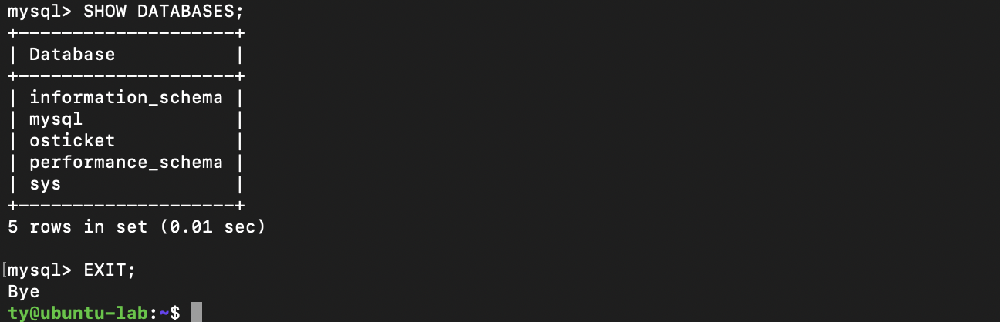

## 3. Deploying osTicket

I downloaded the latest release from GitHub, copied it into Apache's web root, and gave ownership to `www-data` (the account Apache runs as). The installer confirmed that every requirement and recommended extension was present.

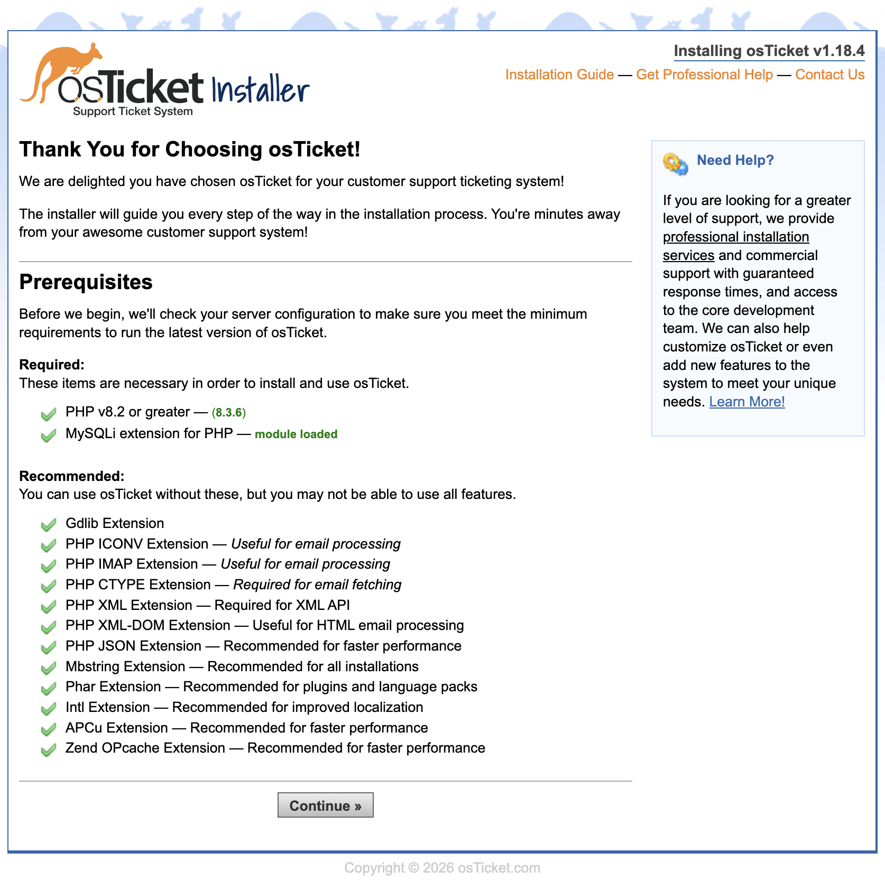

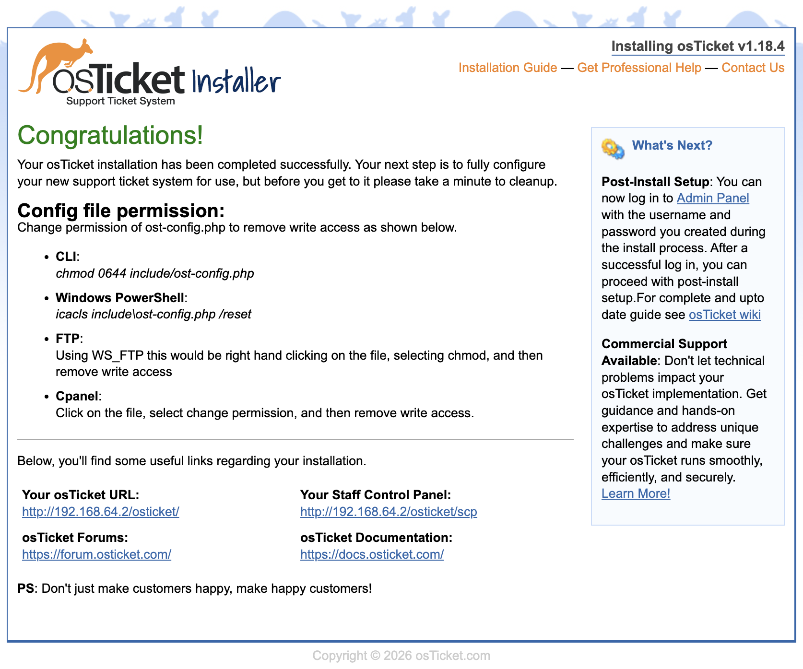

## 4. Post-install hardening

After installation I deleted the setup directory, so nobody can rerun the installer and reconfigure the system, and set the config file to read-only.

```bash
sudo rm -rf /var/www/html/osticket/setup
sudo chmod 0644 /var/www/html/osticket/include/ost-config.php
```

The config file now shows `-rw-r--r--` (owner can read and write; everyone else can only read).

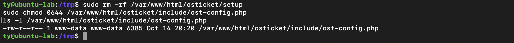

I also reviewed the agent authentication settings. Accounts lock after 4 failed logins, which mirrors the account lockout policy I set with Group Policy in my [Active Directory lab](https://github.com/ty-vinyard/azure-active-directory-lab).

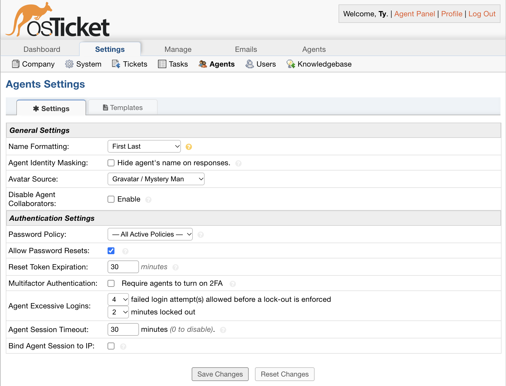

## 5. Configuring the help desk

**Departments:** IT Support, Network Operations, Security

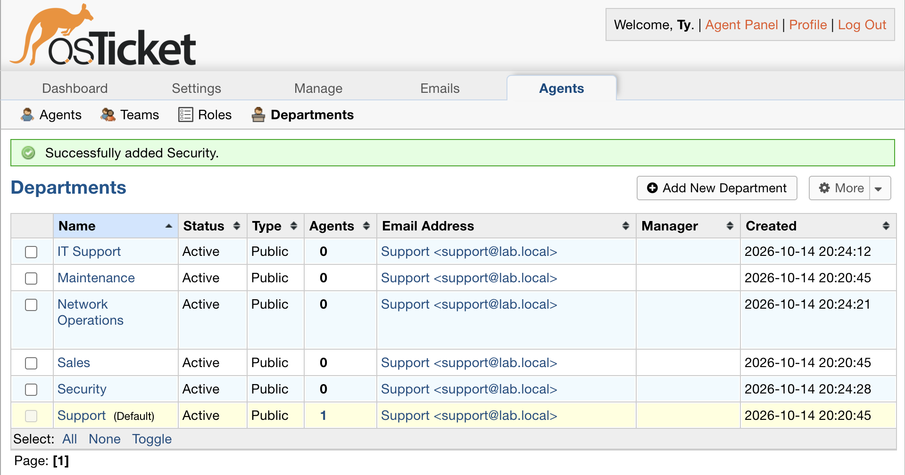

**SLA plans:**

| SLA | Grace period | Used for |
|---|---|---|
| Priority 1 - Critical | 4 hours | Lockouts, outages, security reports |
| Priority 2 - Standard | 24 hours | Software requests, hardware issues |

**Help topics:** each topic routes the ticket to the right department and SLA automatically.

| Help topic | Department | SLA |
|---|---|---|
| Account Lockout / Password Reset | IT Support | Priority 1 |
| Network / Internet Issue | Network Operations | Priority 1 |
| Suspected Phishing Email | Security | Priority 1 |
| Software Installation | IT Support | Priority 2 |
| Hardware Problem | IT Support | Priority 2 |

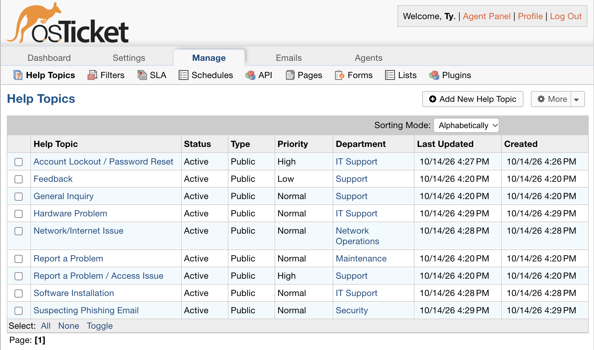

**Agents:** I added a second agent (Alex Lee, IT Support) so tickets could be delegated.

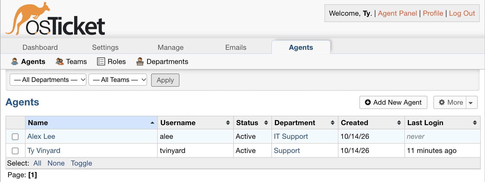

## 6. Working the ticket queue

I submitted five tickets from the customer portal as different users, then worked them as an agent.

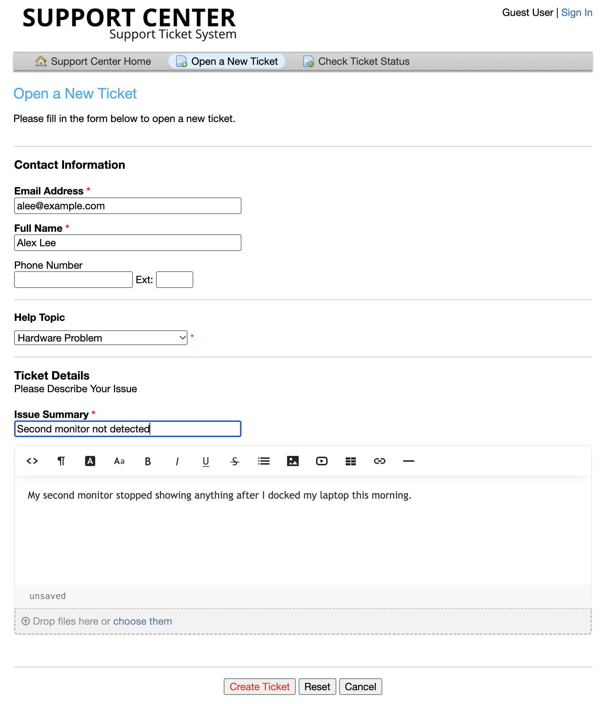

**Triage first.** The phishing report and the "no internet" ticket came in as Normal, so I raised them to High before working anything. Every ticket was then assigned, and the Zoom request was delegated to the second agent.

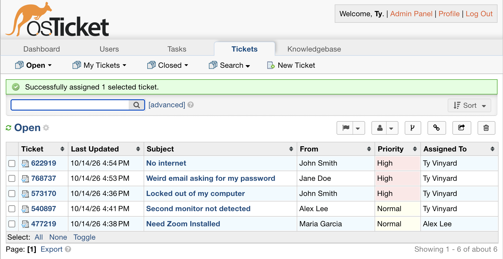

**For each ticket:**
- An **internal note** recorded the technical troubleshooting. Only agents can see it.
- A **reply** told the user in plain language what was fixed.
- The ticket was marked **Resolved**.

| Ticket | Scenario | Resolution |
|---|---|---|
| Locked out of my computer | Account lockout | Verified identity, found the locked account with `Search-ADAccount -LockedOut`, ran `Unlock-ADAccount` |
| Weird email asking for my password | Phishing report | Reviewed headers (spoofed sender), blocked the domain, checked other mailboxes, confirmed no credentials were entered |
| No internet | DNS failure | Ping to 8.8.8.8 worked but `nslookup` failed, so the problem was isolated to DNS; flushed DNS and renewed the IP |
| Need Zoom installed | Software request | Confirmed it's approved software, installed it and tested |
| Second monitor not detected | Hardware | Reseated the dock cable, detected the display, checked the dock driver |

*The tickets are simulated scenarios. The troubleshooting steps reflect commands and procedures I've practiced in my lab environments.*

**Phishing ticket, start to finish:** user report → triage to High → claim → internal note → reply → resolved.

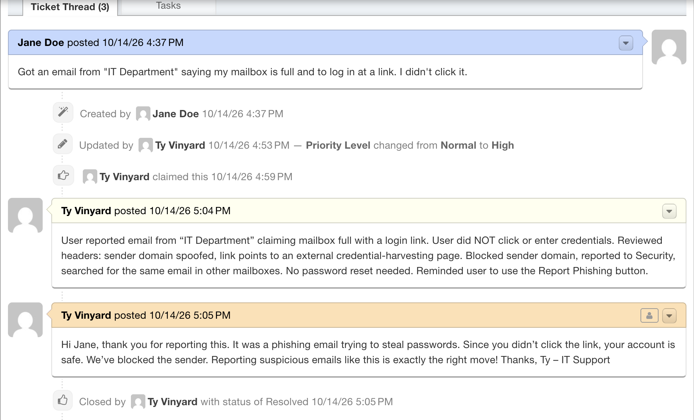

**DNS ticket:**

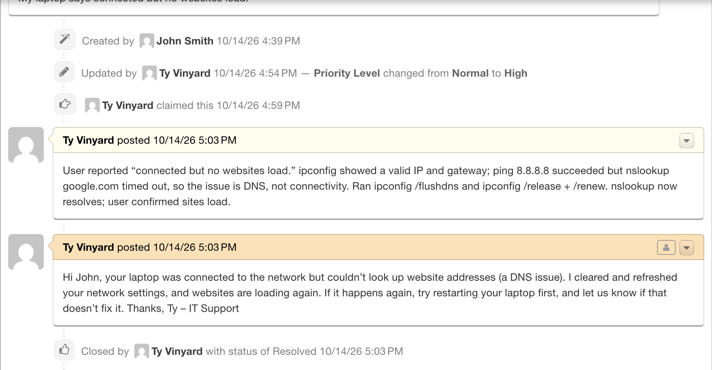

**All five tickets resolved:**

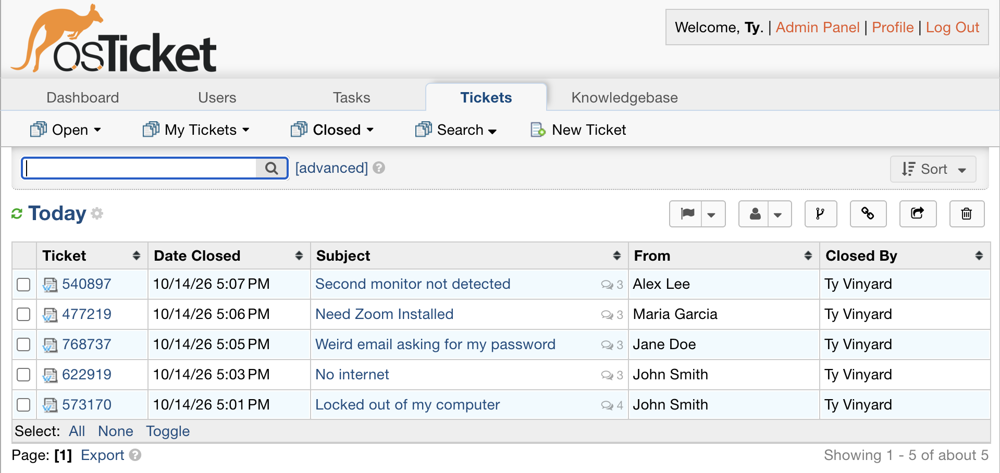

---

## Troubleshooting along the way

- **SSH timed out after a kernel update and reboot.** I worked through it layer by layer:
  - Confirmed the VM's IP hadn't changed (`ip a`).
  - Confirmed SSH was listening on port 22 (`ss -tlnp`). Ubuntu 24.04 uses socket activation, so `ssh.service` showing "inactive" is normal.
  - Confirmed UFW allowed OpenSSH.
  - Confirmed the host could reach the VM with `ping`.
  - Retrying once the VM had fully booted fixed it.

  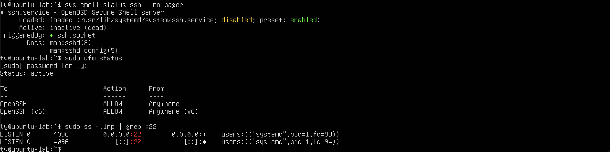
- **Bash history expansion.** A password containing `!` inside double quotes broke a `mysql -e` command (`event not found`). Running the statement inside the MySQL prompt avoided it.
- **Agent email validation.** osTicket rejected a `.local` email address for agents. I used the reserved `example.com` domain for test accounts.

## What I Learned

- How a web application stack fits together: Linux hosts it, Apache serves it, PHP runs the code, MySQL stores the data.
- Least privilege applies to service accounts too. The app's database user can only touch its own database.
- Leftover installers and writable config files are real attack surface, so hardening is part of every deployment.
- How a help desk actually runs: tickets get routed by topic, prioritized by SLA, triaged before they're worked, and documented differently for agents (internal notes) and users (replies).
- Troubleshooting is about isolating the layer. "Connected but no websites" splits into IP connectivity versus DNS with two commands.

## Screenshot Index

| # | Screenshot |
|---|---|
| 01 | [Installer prereqs](screenshots/01-installer-prereqs.png) |
| 02 | [Install complete](screenshots/02-install-complete.png) |
| 03 | [Database created](screenshots/03-database-created.png) |
| 04 | [Hardening](screenshots/04-hardening.png) |
| 05 | [Agent lockout policy](screenshots/05-agent-lockout-policy.png) |
| 06 | [Departments](screenshots/06-departments.png) |
| 07 | [Help topics](screenshots/07-help-topics.png) |
| 08 | [Agents](screenshots/08-agents.png) |
| 09 | [User submits ticket](screenshots/09-user-submits-ticket.png) |
| 10 | [Queue triaged](screenshots/10-queue-triaged.png) |
| 11 | [Phishing ticket](screenshots/11-phishing-ticket.png) |
| 12 | [Dns ticket](screenshots/12-dns-ticket.png) |
| 13 | [Closed tickets](screenshots/13-closed-tickets.png) |
| 14 | [Ssh troubleshooting](screenshots/14-ssh-troubleshooting.png) |

## Related project

- [Azure Active Directory Lab](https://github.com/ty-vinyard/azure-active-directory-lab): domain controller, OUs, RBAC groups, Group Policy, and the account lockout/unlock drills these tickets are based on.
